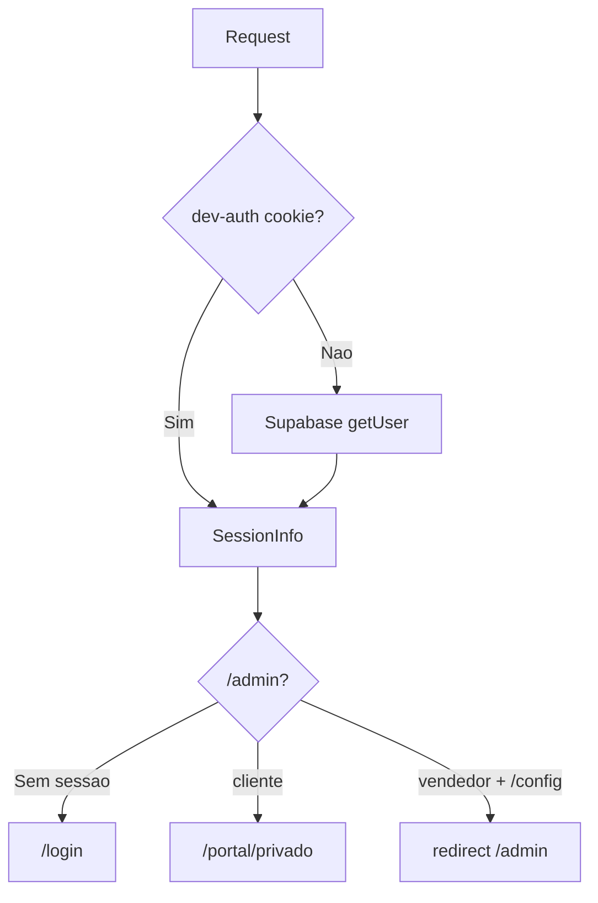

# Auth e permissões

> **Propósito:** Documentar autenticação, roles e ACL de vendedores.  
> **Público:** Desenvolvedores.  
> **Última verificação:** 2026-11-19

## Roles

| Role | Origem | Acesso |
|------|--------|--------|
| `admin` | `user_metadata.role` ou dev-auth | `/admin` completo incl. `/admin/config` |
| `vendedor` | idem | `/admin` excepto `/admin/config`; permissões por secção |
| `cliente` | default Supabase / dev-auth | `/portal/privado` |

## Middleware

[`src/middleware.ts`](../../src/middleware.ts) — matcher: `/admin/*`, `/portal/privado/*`, `/login`.

**Prioridade:** cookie `dev-auth` > Supabase.

Cookies Supabase refrescadas durante `getUser()` são copiadas para redirects (evita perder sessão).

## Login

[`src/app/login/actions.ts`](../../src/app/login/actions.ts):

1. Email em `DEV_USERS` → cookie `dev-auth`, redirect por role
2. Caso contrário → Supabase `signInWithPassword` / `signUp`
3. Sign-up cria `comprador` via `upsertComprador`

Contas demo — ver [setup-local.md](../getting-started/setup-local.md).

## Auth no servidor

[`src/lib/auth-server.ts`](../../src/lib/auth-server.ts):

- `getServerSession()` — role, email, ids vendedor/comprador
- `requireAdmin()` — aborta se não admin
- `requireAdminOrVendor()` — admin ou vendedor
- `requireEditPermission(section)` — verifica ACL vendedor

## Permissões vendedor (UI)

[`src/lib/permissions.ts`](../../src/lib/permissions.ts) define secções: `activos`, `compradores`, `ofertas`, etc.

- `canViewSection` / `canEditSection` — [`auth-helpers.ts`](../../src/lib/auth-helpers.ts)
- Layout admin filtra nav: [`src/app/admin/layout.tsx`](../../src/app/admin/layout.tsx)
- `VendorGuard` — guard por página

Tabela DB: `vendedor_permissions`. Actions: [`permissions.ts`](../../src/app/actions/permissions.ts).

## Portal auth

[`src/hooks/usePortalAuth.ts`](../../src/hooks/usePortalAuth.ts) — distingue staff (vê catálogo completo) vs visitante/comprador.

## RLS Supabase

Políticas em `supabase-schema.sql` e `supabase-dev-policies.sql`. Função helper `is_admin()` para políticas admin.

Writes sensíveis usam **service-role** nas server actions (bypass RLS controlado no código).

**Notas de activo:** `fetchNotas` / `createNota` filtram no servidor (service role, para a cookie demo). O agente só recebe notas de activo com o seu `author_id` (ou o nome, nas linhas antigas sem id). O admin recebe todas do alcance pedido. `scope = privada` só admin. `deleteNota` exige `requireAdmin()`. Não há política DELETE para vendedor nem comprador. No PostgREST, SELECT de agente é `notas_agente_select` e o DELETE directo só passa com `public.is_admin()` (`notas_admin_delete`). O nome visível resolve-se em `displayCommentAuthor`: rol `admin` → «Gestor»; sem autor → «Gestor»; agente ou comprador → o nome. Cada comentário mostra também data e hora.

**Compradores do agente:** a secção `/admin/compradores` fica sempre visível para o vendedor (o ACL de `vendedor_permissions` não a esconde). A lista e as escritas passam por service role depois de validar a sessão: o agente só lê e edita os compradores de `vendedor_compradores` onde ele é o `vendedor_id`. Pode criar compradores (ficam atribuídos a ele, sem acesso ao portal). Não reatribui, não apaga e não muda o acesso ao portal. O admin vê e gere todos e pode reatribuir. A ficha de firma (nome, apelidos, documento, morada) segue a mesma regra. O próprio comprador só a edita em `/portal/privado/datos`, sem mudar o email da conta. A RLS de `vendedores` em staging esconde a própria fila do agente, por isso o `vendedorId` resolve-se com service role, como no resto das actions de agente.

**Prazo de 90 dias:** `compradores.ultima_gestion_agente_at` regista a última gestão do agente atribuído (alta, edição da ficha, comentário de chamada/ação, oferta ligada a esse comprador). A gestão do admin não reinicia o relógio. Ao atribuir um agente novo, o prazo começa nessa atribuição. Se passam 90 dias, `reasignar_compradores_inactivos` tira a atribuição, deixa `agente = 'Admin'`, grava `reasignado_inactividad_at` e insere o comentário «Reasignado a Gestor por 90 días sin gestión». Corre no cron (`CRON_SECRET`) e ao listar. A UI mostra os dias que faltam e avisa quando faltam menos de 15. Migração: `supabase/migrations/20261119c_compradores_gestion_agente.sql` (as filas já existentes nascem com `now()`, para não serem reatribuídas de uma vez).

**Comentários do comprador:** `comprador_comentarios`. Admin lê e escreve todos. O agente só se `vendedor_compradores` o liga a esse comprador. O comprador não tem política. A action usa service role e repete a regra (cookie demo). Um comentário do agente atribuído também actualiza `ultima_gestion_agente_at`.

**Información adicional:** tabela `asset_informacion_adicional`, uma fila por activo. `fetchInformacionAdicional` deixa admin e vendedor. `saveInformacionAdicional` recusa quem não é admin. RLS: `informacion_adicional_admin` (ALL) e `informacion_adicional_agente_select` (SELECT). Sem política para anon nem comprador. Não lê `notas`.

**Documentos:** `fetchDocumentos` / `getDocumentUrl` usam service role depois da sessão. Admin vê tudo, sem NDA. Vendedor só se `vendedor_assets` contém o activo **e** aceitou o NDA dessa versão para esse activo (`asset_nda_aceptaciones`). O NDA de A não abre B. Comprador só filas com o seu `comprador_id`; se a fila tem `asset_id`, também exige o NDA desse activo. Sem NDA a action responde `NDA no aceptado` e não assina a URL. `getDocumentUrl` usa `createSignedUrl` (1 h) e não chama `getPublicUrl`. A política `documentos_agente_select` repete o SELECT do agente no PostgREST. `documentos_admin` e `documentos_client_read` mantêm-se.

**NDA por activo:** texto provisional em `src/lib/nda.ts` (`ASSET_NDA_VERSION`). A aceitação guarda activo, `auth.users.id`, nome escrito, data, IP, user-agent e versão. RLS: admin tudo; agente e comprador só `user_id = auth.uid()` (sem ler `vendedores`). A app usa service role.

## Ficheiros relacionados

- [`src/middleware.ts`](../../src/middleware.ts)
- [`src/lib/dev-auth-client.ts`](../../src/lib/dev-auth-client.ts)
- [primeiro-acesso.md](../getting-started/primeiro-acesso.md)
